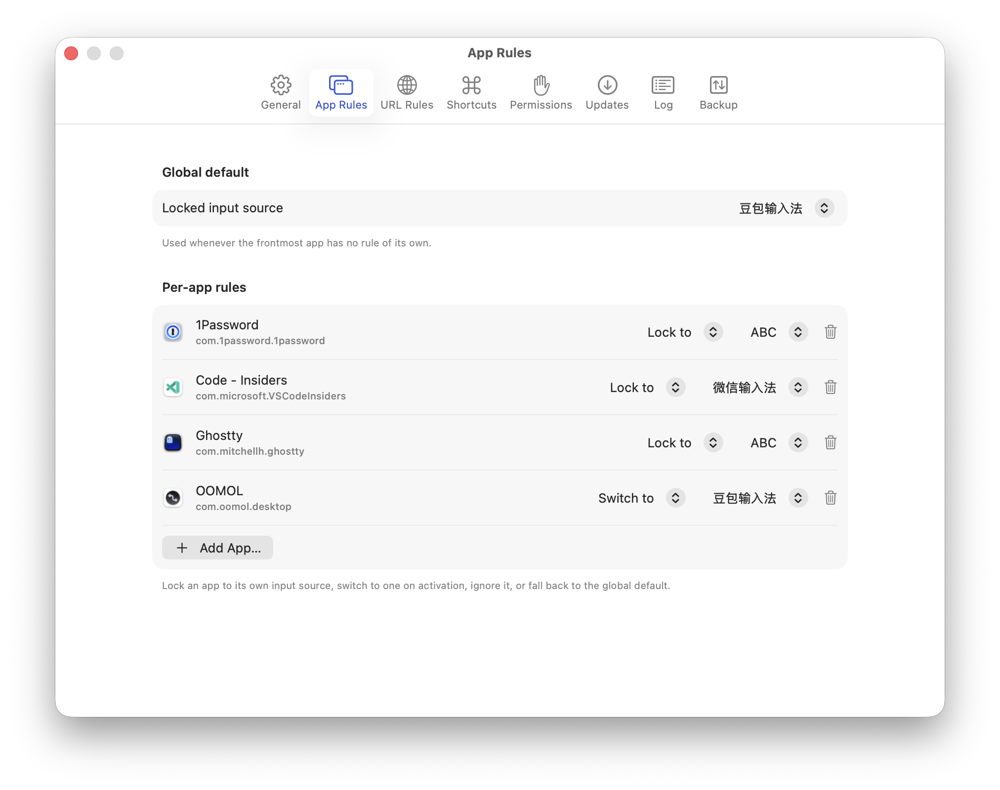

<div align="center">


# LockIME

[English](../../README.md) · [简体中文](README.zh-CN.md) · [繁體中文](README.zh-TW.md) · [日本語](README.ja.md) · [Français](README.fr.md) · [Deutsch](README.de.md) · **Español** · [Português](README.pt.md) · [Русский](README.ru.md)

[](https://github.com/oomol-lab/LockIME/releases/latest)
[](https://github.com/oomol-lab/LockIME/actions/workflows/ci.yml)
[](../../LICENSE)
[](https://www.apple.com/macos/)
[](https://swift.org)
[](https://www.greptile.com/?utm_source=oss_badge&utm_medium=readme&utm_campaign=greptile_for_open_source)

</div>

LockIME es una aplicación de barra de menús para macOS que bloquea tu fuente de entrada de teclado. Si tú u otra aplicación cambia el método de entrada, vuelve a la bloqueada al instante: de forma global, por aplicación o por URL del navegador.

<p align="center">
  <picture>
    <source media="(prefers-color-scheme: dark)" srcset="../images/settings-general-en-dark.png">
    
  </picture>
  <picture>
    <source media="(prefers-color-scheme: dark)" srcset="../images/settings-app-rules-en-dark.png">
    
  </picture>
  <picture>
    <source media="(prefers-color-scheme: dark)" srcset="../images/settings-url-rules-en-dark.png">
    
  </picture>
</p>

## Install

```sh
brew install --cask oomol-lab/tap/lockime
```

O descarga el `.dmg` desde la [última versión](https://github.com/oomol-lab/LockIME/releases/latest): `-arm64` para Apple silicon, `-x86_64` para Intel. Requiere macOS 14 o posterior. LockIME se actualiza mediante Sparkle, en un canal stable o beta.

## Features

- **Bloquear o cambiar.** Una regla para una aplicación o URL bloquea una fuente de entrada, volviendo a ella cada vez que cambia, o cambia a ella una sola vez cuando activas la aplicación o la página y luego te deja libre.
- **Predeterminada global.** Bloquea una fuente de entrada en todas partes, cambia a ella una vez en cada aplicación que recurre a la predeterminada, o elige *Ninguna* y deja que tus reglas hagan todo el trabajo.
- **Reglas de URL y de barra de direcciones.** El bloqueo básico no necesita permisos del sistema. Un modo mejorado opcional pide el permiso de Accessibility y añade reglas por URL y para la barra de direcciones del navegador. Las reglas de URL coinciden por un dominio y sus subdominios, un dominio exacto, una palabra clave o una expresión regular sobre la URL completa; arrástralas para fijar la prioridad, y la primera coincidencia gana.
- **Ejecutables sin bundle.** Los programas sin bundle `.app`, como el `java` de Minecraft, aparecen en el selector de aplicaciones como `process:java` mientras están en ejecución.
- **Gestión de conflictos.** Cuando otro programa impone una y otra vez su propia fuente de entrada, LockIME se aparta en lugar de pelear y anota el conflicto en el registro. Dale a esa aplicación una regla *Ignorar* o *Cambiar a* para una solución duradera.
- **Barra de menús y atajos.** Activa o desactiva LockIME y cambia la fuente de entrada bloqueada desde la barra de menús o con atajos globales. Los atajos también pueden recorrer o eliminar la regla de la aplicación en primer plano.
- **Registro de activaciones.** Las últimas 24 horas: qué se cambió, por qué y durante cuánto tiempo.
- **Copia de seguridad.** Exporta las reglas a un archivo `.lockime`. Al importar se previsualizan las adiciones, los conflictos y las eliminaciones antes de aplicar nada.
- **Además:** inicio al iniciar sesión, 9 idiomas de interfaz que se cambian sin reiniciar y una descarga de menos de 3 MB.

## Comparison

[Input Source Pro](https://github.com/runjuu/InputSourcePro) y [KeyboardHolder](https://github.com/leaves615/KeyboardHolder) cambian la fuente de entrada cuando pasas de una aplicación o un sitio a otro. LockIME además la mantiene: una fuente de entrada bloqueada se vuelve a aplicar cada vez que cambia.

| | LockIME | Input Source Pro | KeyboardHolder |
|---|---|---|---|
| Código abierto | GPL-3.0 | GPL-3.0 | ✗ |
| macOS mínimo | 14 | 11 | 10.15 |
| Tamaño de descarga | < 3 MB | ≈ 7.6 MB | ≈ 4.5 MB |
| Rebloqueo continuo | ✓ | ✗ | ✗ |
| Bloqueo o cambio único, por regla | ✓ | ✗ | ✗ |
| Tipos de coincidencia de URL | subdominio, exacto, palabra clave, regex | subdominio, exacto, regex | dominio (comodín) |
| Regla de barra de direcciones | ✓ (bloqueo/cambio/prioridad) | ✓ (fuente predeterminada) | — |
| Atajos de teclado globales | ✓ | ✓ | ✗ |
| Indicaciones de entrada en pantalla | ✗ | ✓ | ✓ (opcional) |
| Registro de activaciones de 24 horas | ✓ | ✗ | ✗ |
| Copia de seguridad / importación de la configuración | ✓ (`.lockime`, con revisión) | ✓ (exportación/importación + CLI) | — |
| Automatización con esquema de URL | ✓ (`lockime://`, x-callback-url) | parcial (importación `inputsourcepro://`) | ✗ |
| Idiomas de la interfaz | 9 | 6 | 3 |

> Comparado con Input Source Pro 2.11.0 y KeyboardHolder 1.14.10, a mediados de 2026. «—» indica una capacidad no documentada, no una ausencia confirmada. Se agradecen las correcciones.

## Automation

Un esquema de URL `lockime://` permite que scripts, Shortcuts y otras aplicaciones activen o desactiven LockIME, cambien la fuente de entrada bloqueada, gestionen reglas y lean el estado mediante [x-callback-url](https://x-callback-url.com). Está desactivado por defecto; actívalo en **Ajustes ▸ General ▸ Automatización**.

```sh
open "lockime://lock"
open "lockime://lock-to-source?id=com.apple.keylayout.ABC"
open "lockime://set-app-rule?bundle=com.apple.Terminal&mode=lock&source=com.apple.keylayout.ABC"
```

Referencia completa: [URL Scheme API](../URL-Scheme-API/README.es.md).

## Development

Requiere Xcode 26+, [XcodeGen](https://github.com/yonaskolb/XcodeGen) y [xcbeautify](https://github.com/cpisciotta/xcbeautify) (`brew install xcodegen xcbeautify`). El proyecto de Xcode se genera a partir de `project.yml` y no está versionado.

```sh
make gen      # generate LockIME.xcodeproj from project.yml
make build    # build (Debug)
make run      # build & launch
make test     # run unit tests
make test-hw  # integration tests; briefly changes the input source
```

La lógica vive en `LockIMEKit`, una biblioteca estática con pruebas unitarias que solo usa frameworks del sistema. El target de aplicación `LockIME` contiene la interfaz SwiftUI y las integraciones de Sparkle, KeyboardShortcuts y PermissionFlow. El icono de la aplicación se genera con `./scripts/make-appicon.sh`.

Consulta [docs/DESIGN.md](../DESIGN.md) para el sistema de diseño y [docs/RELEASING.md](../RELEASING.md) para el proceso de publicación.

## License

[GPL-3.0](../../LICENSE). Copyright © 2026 Hangzhou Wumou Software Co., Ltd.
