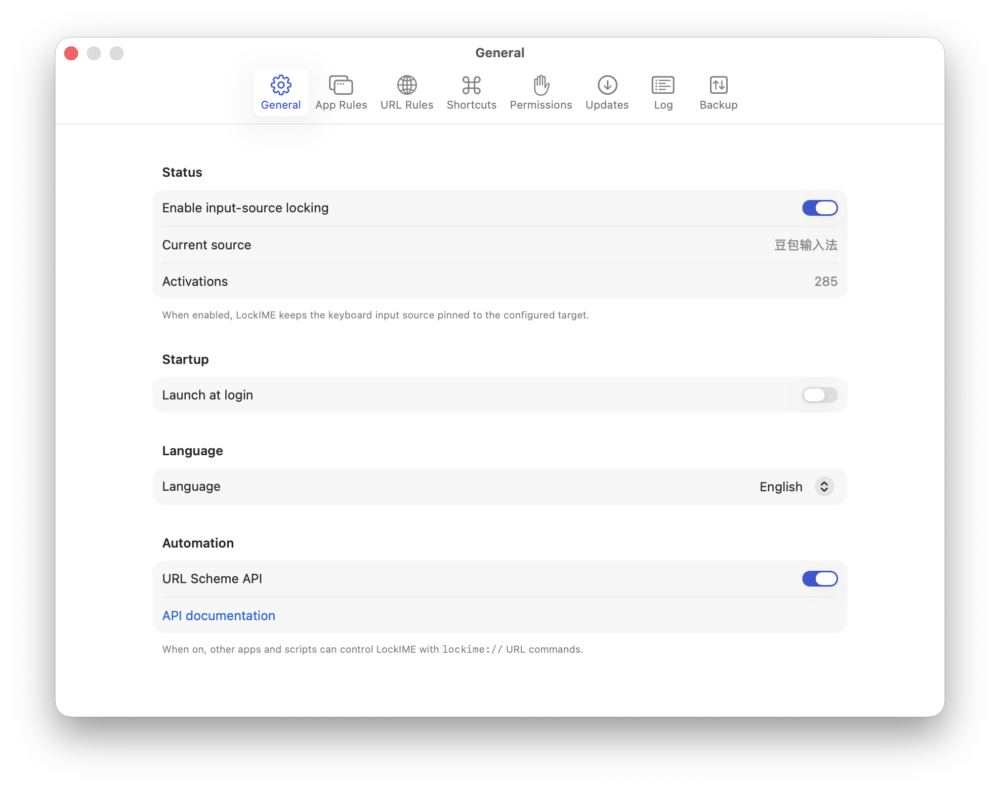
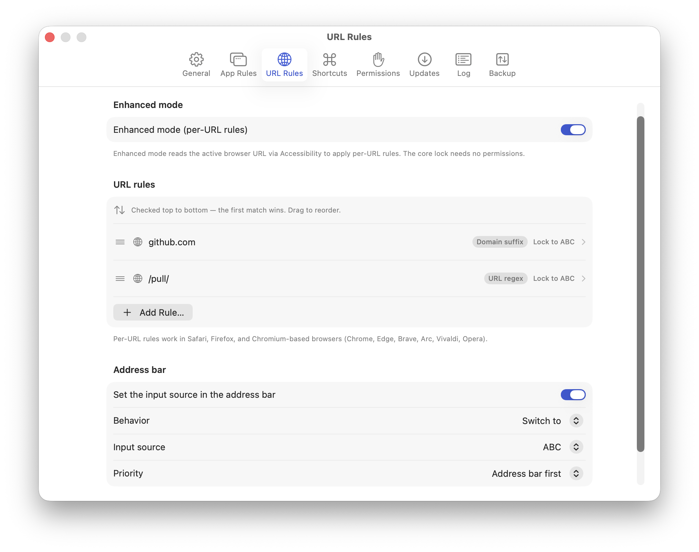

<div align="center">


# LockIME

[English](../../README.md) · [简体中文](README.zh-CN.md) · [繁體中文](README.zh-TW.md) · **日本語** · [Français](README.fr.md) · [Deutsch](README.de.md) · [Español](README.es.md) · [Português](README.pt.md) · [Русский](README.ru.md)

[](https://github.com/oomol-lab/LockIME/releases/latest)
[](https://github.com/oomol-lab/LockIME/actions/workflows/ci.yml)
[](../../LICENSE)
[](https://www.apple.com/macos/)
[](https://swift.org)
[](https://www.greptile.com/?utm_source=oss_badge&utm_medium=readme&utm_campaign=greptile_for_open_source)

</div>

LockIME は、キーボードの入力ソースをロックする macOS メニューバーアプリです。あなたや他のアプリが入力ソースを切り替えると、すぐに元へ戻します。グローバルにも、アプリごとにも、ブラウザの URL ごとにも設定できます。

<p align="center">
  <picture>
    <source media="(prefers-color-scheme: dark)" srcset="../images/settings-general-en-dark.png">
    
  </picture>
  <picture>
    <source media="(prefers-color-scheme: dark)" srcset="../images/settings-app-rules-en-dark.png">
    
  </picture>
  <picture>
    <source media="(prefers-color-scheme: dark)" srcset="../images/settings-url-rules-en-dark.png">
    
  </picture>
</p>

## Install

```sh
brew install --cask oomol-lab/tap/lockime
```

または[最新リリース](https://github.com/oomol-lab/LockIME/releases/latest)から `.dmg` をダウンロードしてください。Apple silicon は `-arm64`、Intel は `-x86_64` です。macOS 14 以降が必要です。LockIME は Sparkle で自動アップデートされ、stable と beta のチャンネルがあります。

## Features

- **ロックまたは切り替え。** アプリや URL のルールは、入力ソースをロックして変更されるたびに戻すことも、アプリやページをアクティブにしたときに一度だけ切り替えて、その後は自由に変更できるようにすることもできます。
- **グローバルのデフォルト。** 1 つの入力ソースをどこでもロックするか、デフォルトにフォールバックするアプリで一度だけ切り替えるか、*なし*にしてルールだけに任せるかを選べます。
- **URL とアドレスバーのルール。** コアのロックにシステム権限は不要です。オプションの拡張モードは Accessibility 権限を必要とし、URL ごと、およびブラウザのアドレスバー用のルールを追加します。URL ルールは、ドメインとそのサブドメイン、完全一致のドメイン、キーワード、または URL 全体に対する正規表現でマッチします。ドラッグして優先順位を決め、最初にマッチしたものが適用されます。
- **素の実行ファイル。** Minecraft の `java` のように `.app` バンドルを持たないプログラムは、実行中のあいだアプリピッカーに `process:java` として表示されます。
- **競合の処理。** 別のプログラムが自分の入力ソースを強制し続ける場合、LockIME は張り合わずに身を引き、その競合をログに記録します。そのアプリに*無視*または*切り替え先*のルールを設定すれば恒久的に解決します。
- **メニューバーとショートカット。** メニューバーまたはグローバルショートカットから、LockIME のオン/オフとロック中の入力ソースの変更ができます。ショートカットでは最前面のアプリのルールを切り替えたり解除したりもできます。
- **作動ログ。** 直近 24 時間に何が、なぜ、どのくらいの時間切り替えられたかを確認できます。
- **バックアップ。** ルールを `.lockime` ファイルに書き出せます。読み込み時には、適用前に追加、競合、削除をプレビューします。
- **そのほか：** ログイン時に起動、再起動なしで切り替えられる 9 つの UI 言語、3 MB 未満のダウンロードサイズ。

## Comparison

[Input Source Pro](https://github.com/runjuu/InputSourcePro) と [KeyboardHolder](https://github.com/leaves615/KeyboardHolder) は、アプリやサイトを移動するたびに入力ソースを切り替えます。LockIME はさらにその状態を維持します。ロックした入力ソースは、変更されるたびに再適用されます。

| | LockIME | Input Source Pro | KeyboardHolder |
|---|---|---|---|
| オープンソース | GPL-3.0 | GPL-3.0 | ✗ |
| 最小 macOS | 14 | 11 | 10.15 |
| ダウンロードサイズ | < 3 MB | ≈ 7.6 MB | ≈ 4.5 MB |
| 継続的な再ロック | ✓ | ✗ | ✗ |
| ルールごとにロックまたは一度きりの切り替え | ✓ | ✗ | ✗ |
| URL マッチタイプ | サブドメイン、完全一致、キーワード、正規表現 | サブドメイン、完全一致、正規表現 | ドメイン (ワイルドカード) |
| アドレスバーのルール | ✓ (ロック/切り替え/優先順位) | ✓ (デフォルトソース) | — |
| グローバルキーボードショートカット | ✓ | ✓ | ✗ |
| 画面上の入力ヒント | ✗ | ✓ | ✓ (オプション) |
| 24 時間の作動ログ | ✓ | ✗ | ✗ |
| 設定のバックアップ / インポート | ✓ (`.lockime`、確認付き) | ✓ (エクスポート/インポート + CLI) | — |
| URL スキーム自動化 | ✓ (`lockime://`、x-callback-url) | 部分的 (`inputsourcepro://` インポート) | ✗ |
| UI 言語 | 9 | 6 | 3 |

> Input Source Pro 2.11.0 と KeyboardHolder 1.14.10 を基準に、2026 年半ばに比較しました。「—」は非対応の確認ではなく、文書化されていないことを示します。訂正を歓迎します。

## Automation

`lockime://` URL スキームを使うと、スクリプト、ショートカット、他のアプリから LockIME のオン/オフ、ロック中の入力ソースの変更、ルールの管理、[x-callback-url](https://x-callback-url.com) による状態の読み取りができます。デフォルトではオフです。**設定 ▸ 一般 ▸ 自動化**でオンにしてください。

```sh
open "lockime://lock"
open "lockime://lock-to-source?id=com.apple.keylayout.ABC"
open "lockime://set-app-rule?bundle=com.apple.Terminal&mode=lock&source=com.apple.keylayout.ABC"
```

詳細なリファレンス：[URL Scheme API](../URL-Scheme-API/README.ja.md)。

## Development

Xcode 26+、[XcodeGen](https://github.com/yonaskolb/XcodeGen)、[xcbeautify](https://github.com/cpisciotta/xcbeautify) が必要です (`brew install xcodegen xcbeautify`)。Xcode プロジェクトは `project.yml` から生成され、リポジトリには含まれません。

```sh
make gen      # generate LockIME.xcodeproj from project.yml
make build    # build (Debug)
make run      # build & launch
make test     # run unit tests
make test-hw  # integration tests; briefly changes the input source
```

ロジックは `LockIMEKit` にあります。システムフレームワークのみを使う、単体テスト済みの静的ライブラリです。`LockIME` アプリターゲットには、SwiftUI の UI と、Sparkle、KeyboardShortcuts、PermissionFlow の統合が含まれます。アプリアイコンは `./scripts/make-appicon.sh` で生成されます。

デザインシステムは [docs/DESIGN.md](../DESIGN.md)、リリース手順は [docs/RELEASING.md](../RELEASING.md) を参照してください。

## License

[GPL-3.0](../../LICENSE)。Copyright © 2026 Hangzhou Wumou Software Co., Ltd.
