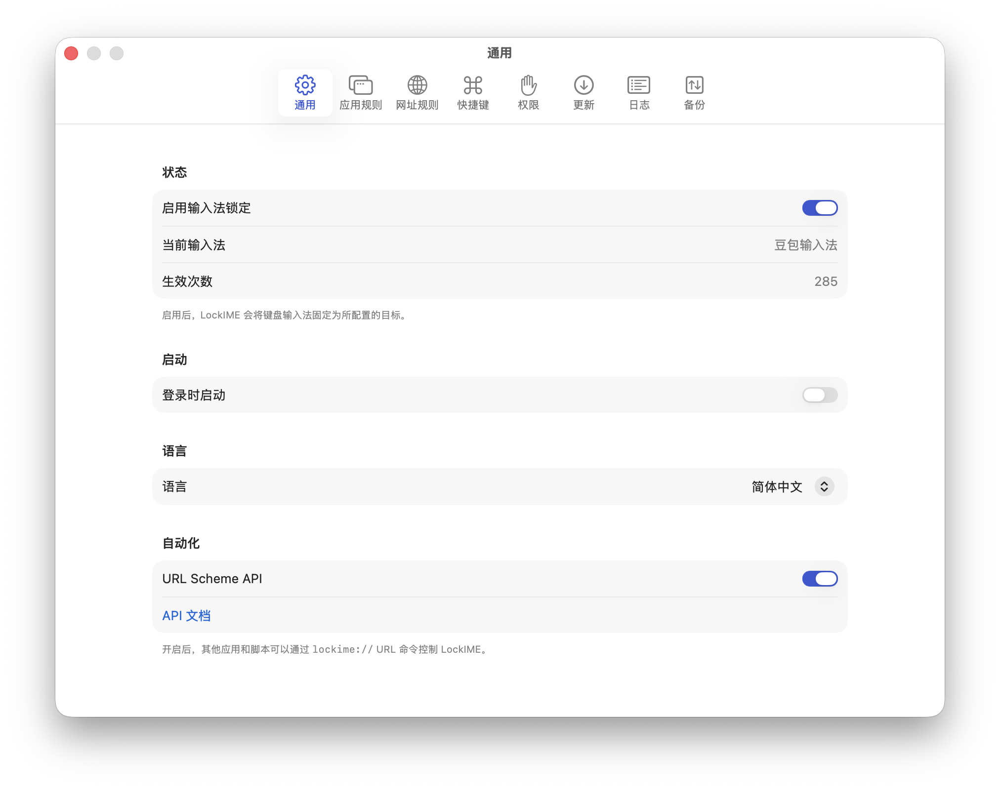
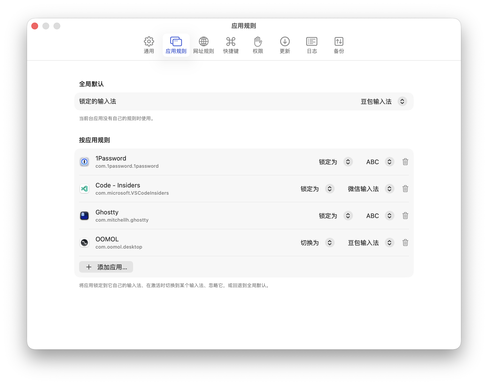
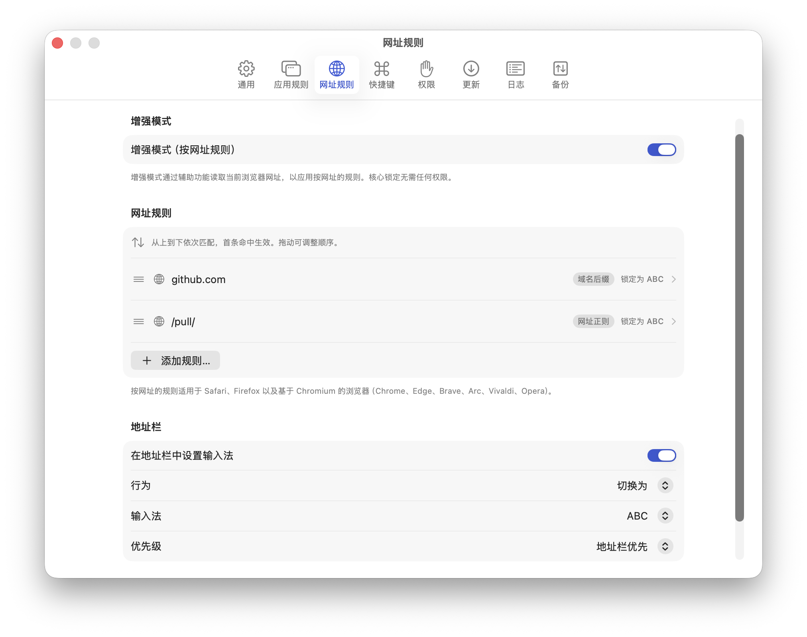

<div align="center">


# LockIME

[English](../../README.md) · **简体中文** · [繁體中文](README.zh-TW.md) · [日本語](README.ja.md) · [Français](README.fr.md) · [Deutsch](README.de.md) · [Español](README.es.md) · [Português](README.pt.md) · [Русский](README.ru.md)

[](https://github.com/oomol-lab/LockIME/releases/latest)
[](https://github.com/oomol-lab/LockIME/actions/workflows/ci.yml)
[](../../LICENSE)
[](https://www.apple.com/macos/)
[](https://swift.org)
[](https://www.greptile.com/?utm_source=oss_badge&utm_medium=readme&utm_campaign=greptile_for_open_source)

</div>

LockIME 是一款 macOS 菜单栏应用，用来锁定键盘输入源。当你或其他应用切换了输入法，它会立刻切回去：可以全局生效，也可以按应用或按浏览器 URL 生效。

<p align="center">
  <picture>
    <source media="(prefers-color-scheme: dark)" srcset="../images/settings-general-zh-CN-dark.png">
    
  </picture>
  <picture>
    <source media="(prefers-color-scheme: dark)" srcset="../images/settings-app-rules-zh-CN-dark.png">
    
  </picture>
  <picture>
    <source media="(prefers-color-scheme: dark)" srcset="../images/settings-url-rules-zh-CN-dark.png">
    
  </picture>
</p>

## Install

```sh
brew install --cask oomol-lab/tap/lockime
```

或者从[最新发布版](https://github.com/oomol-lab/LockIME/releases/latest)下载 `.dmg`：Apple silicon 选 `-arm64`，Intel 选 `-x86_64`。需要 macOS 14 或更高版本。LockIME 通过 Sparkle 自动更新，提供 stable 与 beta 两个通道。

## Features

- **锁定或切换。** 应用或 URL 的规则可以锁定某个输入源，一旦被改动就切回；也可以只在你切到该应用或页面时切换一次，之后任你更改。
- **全局默认。** 可以在所有地方锁定同一个输入源，也可以只在回落到默认的应用里切换一次，或者设为*无*，完全交给规则。
- **URL 与地址栏规则。** 核心锁定不需要任何系统权限。可选的增强模式需要 Accessibility 权限，可按 URL 和浏览器地址栏设置规则。URL 规则可按域名及其子域名、精确域名、关键词，或针对完整 URL 的正则表达式匹配；拖动调整优先级，第一个命中的生效。
- **裸可执行文件。** 没有 `.app` 包的程序，比如 Minecraft 的 `java`，运行期间会以 `process:java` 出现在应用选择器里。
- **冲突处理。** 当另一个程序不断强制改回它自己的输入源时，LockIME 会停手而不是与它来回拉锯，并把这次冲突记入日志。给该应用设置一条*忽略*或*切换为*规则即可彻底解决。
- **菜单栏与快捷键。** 在菜单栏或通过全局快捷键开关 LockIME、更换被锁定的输入源。快捷键还可以切换或移除当前前台应用的规则。
- **激活日志。** 最近 24 小时内切换了什么、为什么、持续了多久。
- **备份。** 把规则导出为 `.lockime` 文件。导入时会先预览新增、冲突与移除项，确认后才应用。
- **此外：** 登录时启动，9 种界面语言无需重启即可切换，下载体积不到 3 MB。

## Comparison

[Input Source Pro](https://github.com/runjuu/InputSourcePro) 和 [KeyboardHolder](https://github.com/leaves615/KeyboardHolder) 会在你切换应用或网站时切换输入源。LockIME 还会让它保持不变：被锁定的输入源一旦被改动就会重新应用。

| | LockIME | Input Source Pro | KeyboardHolder |
|---|---|---|---|
| 开源 | GPL-3.0 | GPL-3.0 | ✗ |
| 最低 macOS | 14 | 11 | 10.15 |
| 下载体积 | < 3 MB | ≈ 7.6 MB | ≈ 4.5 MB |
| 持续重新锁定 | ✓ | ✗ | ✗ |
| 每条规则可锁定或一次性切换 | ✓ | ✗ | ✗ |
| URL 匹配类型 | 子域名、精确、关键词、正则 | 子域名、精确、正则 | 域名 (通配符) |
| 地址栏规则 | ✓ (锁定/切换/优先级) | ✓ (默认输入源) | — |
| 全局键盘快捷键 | ✓ | ✓ | ✗ |
| 屏幕输入提示 | ✗ | ✓ | ✓ (可选) |
| 24 小时激活日志 | ✓ | ✗ | ✗ |
| 配置备份 / 导入 | ✓ (`.lockime`，带审阅) | ✓ (导出/导入 + CLI) | — |
| URL scheme 自动化 | ✓ (`lockime://`，x-callback-url) | 部分 (`inputsourcepro://` 导入) | ✗ |
| 界面语言 | 9 | 6 | 3 |

> 对比基于 Input Source Pro 2.11.0 与 KeyboardHolder 1.14.10，采集于 2026 年中。“—” 表示未记录，而非确认不支持。欢迎指正。

## Automation

通过 `lockime://` URL scheme，脚本、Shortcuts 和其他应用可以开关 LockIME、更换被锁定的输入源、管理规则，并通过 [x-callback-url](https://x-callback-url.com) 读回状态。它默认关闭，请在**设置 ▸ 通用 ▸ 自动化**中开启。

```sh
open "lockime://lock"
open "lockime://lock-to-source?id=com.apple.keylayout.ABC"
open "lockime://set-app-rule?bundle=com.apple.Terminal&mode=lock&source=com.apple.keylayout.ABC"
```

完整参考：[URL Scheme API](../URL-Scheme-API/README.zh-CN.md)。

## Development

需要 Xcode 26+、[XcodeGen](https://github.com/yonaskolb/XcodeGen) 和 [xcbeautify](https://github.com/cpisciotta/xcbeautify) (`brew install xcodegen xcbeautify`)。Xcode 项目由 `project.yml` 生成，不纳入版本控制。

```sh
make gen      # generate LockIME.xcodeproj from project.yml
make build    # build (Debug)
make run      # build & launch
make test     # run unit tests
make test-hw  # integration tests; briefly changes the input source
```

逻辑位于 `LockIMEKit`，这是一个带单元测试、只使用系统框架的静态库。`LockIME` 应用 target 包含 SwiftUI 界面，以及 Sparkle、KeyboardShortcuts 和 PermissionFlow 的集成。应用图标由 `./scripts/make-appicon.sh` 生成。

设计系统见 [docs/DESIGN.md](../DESIGN.md)，发布流程见 [docs/RELEASING.md](../RELEASING.md)。

## License

[GPL-3.0](../../LICENSE)。Copyright © 2026 Hangzhou Wumou Software Co., Ltd.
